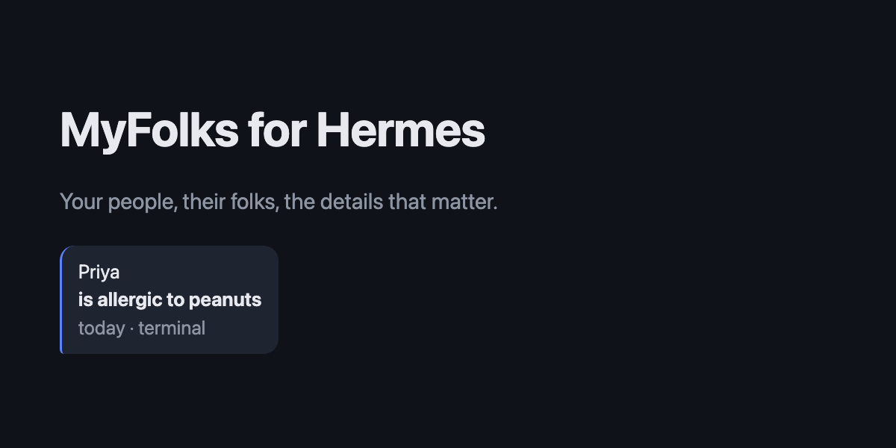
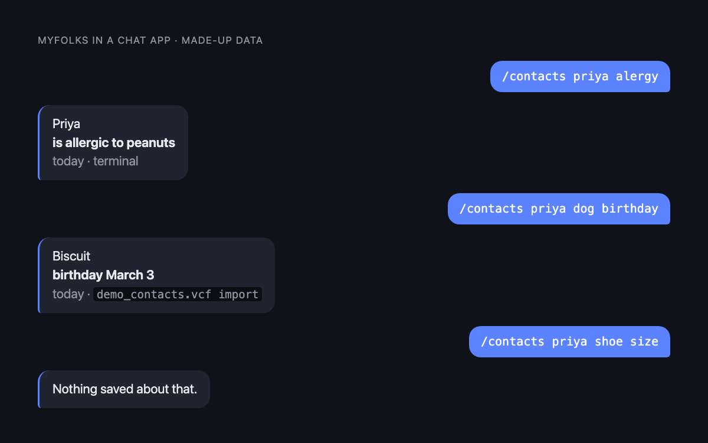
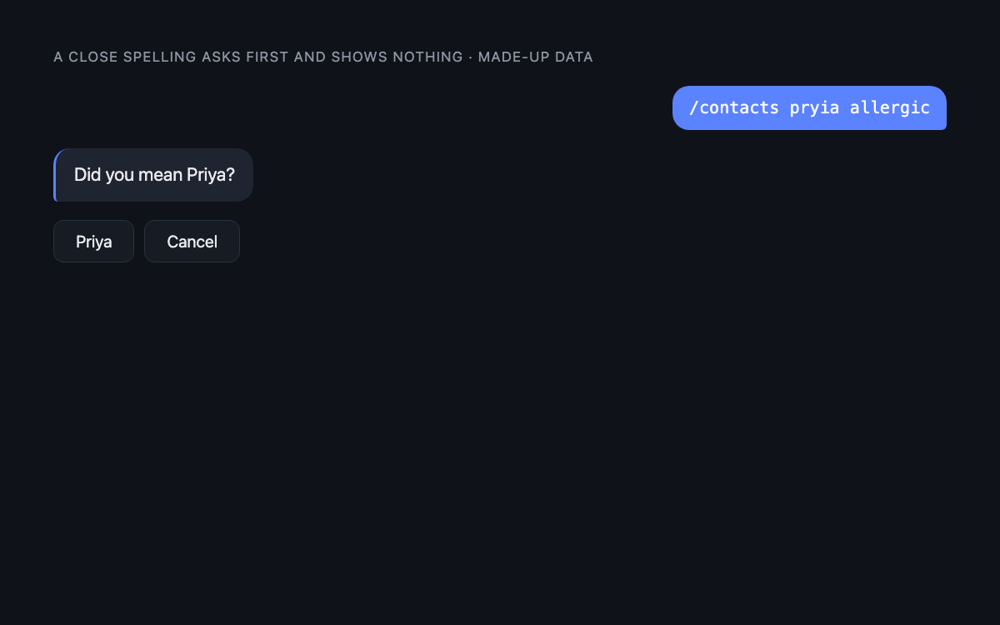
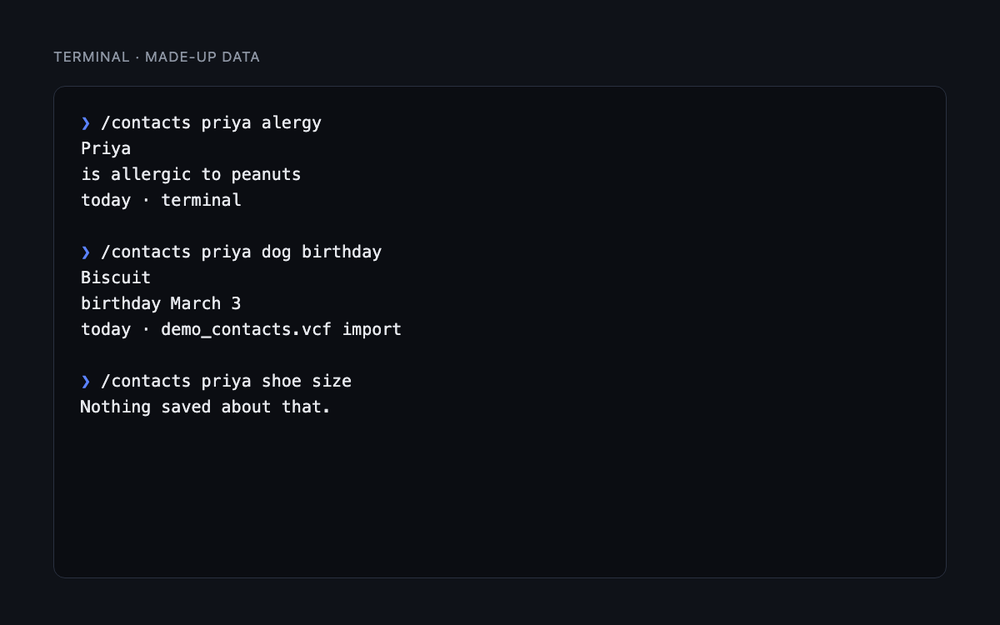
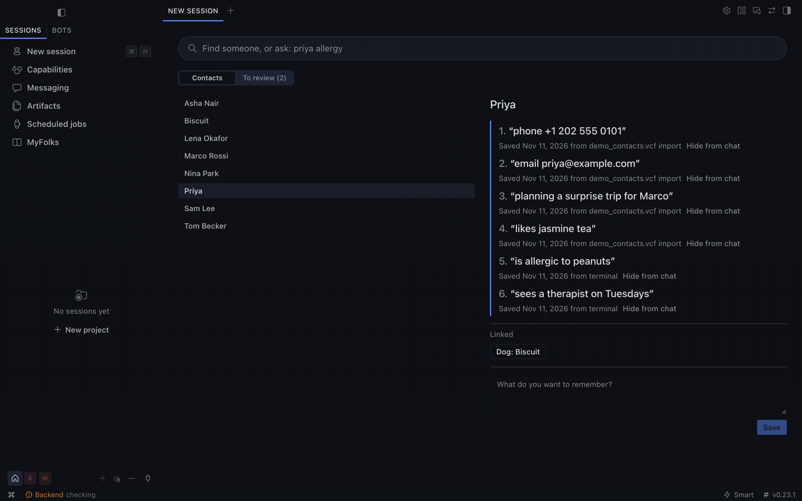
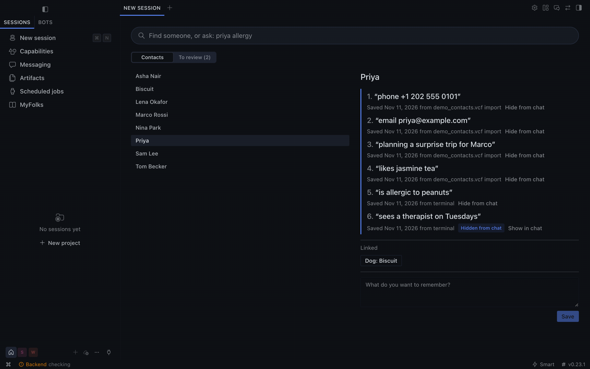

# MyFolks for Hermes



Your people, their folks, the details that matter.

A contact book your agent can't misremember.

## Quick start

1. Install: `hermes plugins install myfolks`
2. Set up once, in your own terminal with `hermes myfolks setup`, or on the MyFolks page in Hermes Desktop. It shows your recovery code once. Chats never show it.
3. From anywhere Hermes works, send `myfolks remember Priya is allergic to peanuts`, then `myfolks priya allergy`.

MyFolks acts on its own only when the result can't be wrong, tells you exactly what it did and how to undo it, and asks you first whenever a guess could be wrong.

Ask about anyone, from anywhere Hermes works, and get back exactly what you saved, word for word, with when and where it came from. If it isn't saved, MyFolks says so. `/contacts` never calls a model, so it keeps answering when your AI is down.

```
/contacts priya allergic

Priya
is allergic to peanuts
June this year · Telegram
```

## What it does



- **Exact answers.** You get back the words you saved.
- **Receipts.** Every answer shows when and where it came from.
- **No guessing.** If it isn't saved: `Nothing saved about that.` If MyFolks is unsure, the answer is marked `not sure`.
- **The right person.** Only an exact name or nickname opens a card. A close spelling asks "Did you mean…?" and shows nothing until you choose.

  
- **Linked cards.** Priya links to their dog Biscuit, so `/contacts priya dog birthday` finds it.
- **Forgiving search.** Most one-letter typos and common synonyms find the right line, with no AI model.
- **Encrypted and local.** One encrypted file on your machine. No account and no cloud.
- **Yours only.** Only you, unless you change a setting. Group chats are refused.
- **Your own words.** Use /contacts, /myfolks, a [wake word](#the-wake-word) you choose with no slash, or [your own short command](#choose-your-own-command).

It works alongside any Hermes memory plugin. It does a different job: exact records, not recall.

## Install

```bash
hermes plugins install myfolks
```

Hermes asks whether to enable the plugin and whether to prepare its one Python dependency, `cryptography`. A running gateway picks up `/contacts` with no restart.

## First setup and your recovery code

Run this in your own terminal, or use the setup screen on the MyFolks page in Hermes Desktop:

```bash
hermes myfolks setup
```

Either shows a recovery code **once**. No chat ever shows it, not even the terminal chat. `/myfolks` with nothing after it shows when and from where MyFolks was set up. Keep it somewhere safe. What you save in MyFolks is stored only on this device. Your address book is separate, and MyFolks never changes it. The recovery code unlocks MyFolks after you restore a Hermes backup, or if MyFolks stops opening. It is not a copy, so also make a backup.

If MyFolks stops opening, or after you restore a Hermes backup on a new device:

```bash
hermes myfolks recover
```

## Commands



| Command | What it does |
|---|---|
| `/contacts` | Short help and how many cards you have |
| `/contacts <name>` | A person's card |
| `/contacts <name> <question>` | Find saved lines, such as `/contacts priya allergic` |
| `/contacts save <name> <text>` | Save a line. An unknown name makes a new card |
| `/contacts link <name> <relation> <name>` | Link two cards, such as `/contacts link Priya dog Biscuit` |
| `/contacts history <name>` | Every line, with exact dates, including corrected ones |
| `/contacts correct <name>` | Numbered lines to pick from |
| `/contacts correct <name> <number> <new text>` | Correct a line. The old value is kept in history |
| `/contacts undo` | Undo the last change |
| `/contacts review` | Imported contacts waiting for you to merge or keep |

Use double quotes for a full name: `/contacts save "Priya Sharma" likes tea`.

`/myfolks` works everywhere `/contacts` does, with no setup.

Saving needs `/contacts save`, `/myfolks save`, or the wake word at the start of a chat app message. Plain chat without these goes to the AI instead of MyFolks.

### Linking as you save

```
/contacts save Mel's dog's name Ollie
/contacts link Mel dog Ollie
/contacts mel dog
```

`Mel's` saves to Mel. When the saved words are exactly one of these, and the name belongs to one card or to nobody yet, MyFolks links them without asking: `dog's name Ollie`, `dog's name is Ollie`, `dog is Ollie`, `dog Ollie`. The reply says `Linked Ollie as Mel's dog. Undo: /contacts undo`. In every other case, such as a name one letter away from another card, it asks first.

### The wake word

In chat apps such as Telegram, start a message with `myfolks`:

- `myfolks remember Mel's dog's name Ollie` saves, and links Ollie as Mel's dog, because the words can't mean anything else. `save`, `keep` and `note` work too.
- `Myfolks, mel dog` looks something up.

The wake word works only at the start of a chat app message. A mention mid-sentence goes to the AI.

With Hermes's default busy setting, the wake word is how to ask in chat apps while Hermes is busy. A `/myfolks` or `/contacts` sent while Hermes is still replying interrupts Hermes's current task and gets "Use myfolks <question> while Hermes is busy." instead, because Hermes doesn't let plugin commands skip its busy handling. In the terminal and Desktop, use `/myfolks`. You can change the wake word, or turn it off, in Settings, then Plugins, then MyFolks, then Agent settings, or in `config.yaml`:

```yaml
plugins:
  entries:
    myfolks:
      settings:
        wake_word: folks
```

Leave it empty (`wake_word: ""`) to turn it off.

### Choose your own command

Hermes's `quick_commands` can add your own name for a command, with `type: alias` and a `target` such as `/contacts save`.

## Import your contacts

```bash
hermes myfolks import <file>
```

Takes vCard files (2.1, 3.0 and 4.0) and CSV exports from Google and Outlook. An exact phone or email match merges, and `/contacts undo` reverses the whole import. Anything else with a similar name waits in `/contacts review`.

Imported text is stored as data and never treated as instructions.

## The Desktop page

1. Open **Capabilities**, then **Plugins**, in Hermes Desktop.
2. Search for `myfolks` and turn on its switch.
3. **MyFolks** appears in the sidebar.

Search, read cards, follow links, save a line and work through your review list.



## Turning on AI use

AI access is **off by default**. To turn it on, go to Settings, then Plugins, then MyFolks, then Agent settings, or set this in `config.yaml`:

```yaml
plugins:
  entries:
    myfolks:
      settings:
        ai_tool: true
```

It takes effect from your next session. Hermes can then look up only the lines that answer a request, and save a new line, telling you what it saved. **Those lines are sent to your configured model provider.** Saved text is passed as data. A close spelling of a name counts as no match. With AI use on, a plain "remember…" message can save through Hermes.

## Sharing with someone

Sharing is off by default. Add people as `platform:sender-id:access`, separated by commas. Access is `read` or `add`. `read` lets someone look up people by name and nothing else: they can't browse cards, open a card by number or see history. `add` also lets them save lines.

```yaml
plugins:
  entries:
    myfolks:
      settings:
        shared_people: "telegram:12345:read, telegram:67890:add"
```

Or use Settings, then Plugins, then MyFolks, then Agent settings. It works only in private chats. Remove an entry to remove the person.

If more than one person is allowed on your bot, link your own account once with `hermes myfolks pair`, then send the code it gives you to your bot in a private chat.

## Backup and restore

What you save in MyFolks is stored only on this device. To keep it if you lose the device, make a backup and keep the file somewhere else.

- **All of Hermes:** a full `hermes backup` includes MyFolks's encrypted store. `hermes backup --quick` does not. On a new device, restore it with `hermes import <file>`, then run `hermes myfolks recover` and enter your recovery code.
- **Only MyFolks:** `hermes myfolks backup` saves `~/myfolks-backup-<date-time>.mfbk`, encrypted with a passphrase you choose. Add `-o` with a file or folder to save it elsewhere. Restore it with `hermes myfolks restore <file>`. Restoring into a new setup gives you a new recovery code.

Restoring over existing contacts asks for your recovery code, then asks you to type `REPLACE`. MyFolks also keeps the last 7 encrypted versions of your store on this device.

`hermes myfolks export <file>` writes an **unencrypted** copy after you type `EXPORT`. Export, backup, restore and pair ask for your recovery code first, typed privately, and do nothing without it.

## Multiple Hermes profiles

The plugin installs into the profile you name, for example `hermes -p work plugins install myfolks`. Each profile needs its own install and `hermes -p work myfolks setup`, and has its own contacts and recovery code. Contacts never cross between profiles. The Desktop page is installed once for the app.

## Advanced: Hide from chat

Hiding stops MyFolks from showing a note in chat. Anything first typed in a chat app remains there until you delete it.



On Desktop, use **Hide from chat** on any line. In the terminal, use `/contacts hide <name> <line number>` and `/contacts unhide <name> <line number>`. `/contacts undo` reverses either.

## What to know before you rely on it

- **Telegram:** bot chats aren't end-to-end encrypted, so questions and answers there pass through Telegram.
- **Exact means exactly what was saved.** MyFolks can't know a detail has gone out of date.
- **Other software on your account:** Hermes runs as you, so anything else running as you, including other enabled plugins and an unsandboxed terminal, is not fully walled off. Running Hermes's terminal in a sandbox is the strongest setup.
- **AI agents with terminal access:** an AI agent with unrestricted terminal access runs as you, with the same reach you have. A sandboxed terminal is the strong setup.
- **The AI file block is a safety net.** A hook blocks AI tools that directly name the store, its key, its versions or your typed history. An indirect route, such as a wildcard in a shell command, can get past it.
- **Typed history:** Hermes keeps a plain-text history of what you type in a terminal, including `/contacts` commands.
- **Lost device or code:** lose this device without a backup and what you saved in MyFolks is gone. Your address book isn't affected. Lose the recovery code and MyFolks keeps working here, but you can't back up, restore, export or pair.

## Disclosures

- **Network:** the plugin makes no network calls. Replies sent over a messaging platform pass through that platform.
- **AI:** `/contacts` uses no model. The optional AI tool is off by default. When on, the lines it returns go to your model provider.
- **Files:** it reads and writes only its own data folder, plus files you name for import, backup, restore or export.
- **Stored credentials:** a device key, in your OS keychain when one is available, otherwise a file only your user can read, in the plugin's data folder.
- **Hooks:** three.
  - `pre_tool_call` checks AI tool calls for direct access to its files. Tool arguments stay on your machine.
  - `pre_gateway_dispatch` answers your own `/myfolks`, `/contacts` and wake word messages in chat apps before Hermes's session sees them, then drops them, so they never reach the AI or the transcript.
  - `pre_llm_call` stops a `/myfolks` or `/contacts` that reaches the AI while Hermes is busy, before any model request, and adds a short note for the AI when a message names MyFolks while AI use is off.

  For any other message, the two message hooks only check the text in memory. They don't open the store and log nothing.
- **Shell commands and background processes:** none.
- **Telemetry:** none.
- **Dependency:** `cryptography`, which Hermes already includes. Declaring it makes Hermes prepare its Python environment when you install.

## Test results

Run these yourself from a checkout, with a Python that has `cryptography`. Measured on made-up data on one Mac unless the row says otherwise. Tested on macOS and Linux. Windows is untested.

| Check | Result | Command |
|---|---|---|
| Search test set | 102 of 108 correct, and no unanswerable question got a direct answer. The 6 misses are printed | `python3 tests/evidence_pack.py` |
| Process killed during save, 25 times | The file was always the old or the new version | `python3 tests/evidence_pack.py` |
| Three processes writing at once | 120 of 120 saves kept | `python3 tests/evidence_pack.py` |
| Wrong key, wrong recovery code, tampered file | Refused, file untouched | `python3 tests/evidence_pack.py` |
| Non-owner, group chat, missing sender | Refused | `python3 tests/evidence_pack.py` |
| Near name | No details shown until you choose | `python3 tests/evidence_pack.py` |
| Lookup at 5,000 cards and 20,000 details | 8.3 ms median, 11.5 ms slowest | `python3 tests/benchmark.py` |
| Save at the same size | 14.5 ms median, 21.5 ms slowest | `python3 tests/benchmark.py` |
| Wake word check on each chat message | 0.38 microseconds median for an ordinary message | `python3 tests/benchmark.py` |
| Lookup while 5,000 contacts import | 1.8 ms median, 68 ms slowest | `python3 tests/benchmark.py` |
| Full test suite | 870 passed on macOS, and 869 passed on Linux in a container, where 1 test is skipped because it runs as root | `python3 -m pytest tests` |
| Plugin check | Passed, security scan `safe` | `hermes plugins validate .` |

## License

MIT. See [LICENSE](LICENSE).
