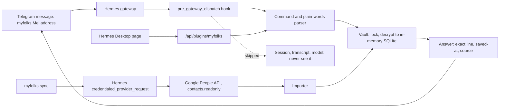

# MyFolks for Hermes


MyFolks is a Hermes Agent plugin that gives Hermes persistent, exact memory about the people in your life: addresses, birthdays, allergies, a friend's child's name. Saving and recall are deterministic code and never call a model, so answers are word for word, carry their source, and keep working when the model is down.

Your people, their folks, the details that matter.

| | |
|---|---|
| **Surfaces** | Telegram (wake word or `/myfolks`), Hermes terminal, Hermes Desktop page. Tested on all three. |
| **Storage** | One SQLite database per Hermes profile, encrypted at rest with AES-256-GCM, decrypted only in memory |
| **Model calls** | None in saving, recall, search, import or sync. Optional AI tool, off by default |
| **Network** | None, unless you run `myfolks sync`: then Google People API, read-only, through Hermes's own OAuth |
| **Dependencies** | Python standard library plus `cryptography` |
| **Quality** | 1,055 automated tests, an evidence pack with 0 failed safety checks, benchmarks at 5,000 people |
| **License** | MIT |

Built for the Nous Research Hermes Agent Plugin Hackathon, Nov 10 to 12, 2026.

## The problem

Agent memory is built for conversation, not records. Summaries and vector recall paraphrase, merge similar people, drop details, and can't say where a fact came from. That is acceptable for "what were we discussing", and not acceptable for "what is Mel's new address".

A typical case: a friend sends their new address. A year later you need it for their baby shower, and you need exactly that address, for exactly that friend, with confidence that it is the latest one. Facts about people need five properties that agent memory does not give:

1. **Exact text**, never a paraphrase.
2. **Provenance**: when and where each fact was saved.
3. **Identity**: the right person, or a question, never a guess.
4. **Correction and deletion** with history and undo.
5. **Privacy**: encrypted, owner only, and out of the model's context by default.

## Requirements and how they are met

| ID | Requirement | Design | Verified by |
|---|---|---|---|
| R1 | Answers are the saved words, with when and where they were saved | Stored text is never rewritten; every answer quotes the line, its time and its source | `tests/test_answer_format.py`, search set in `tests/evidence_pack.py` |
| R2 | Never answer about the wrong person | Only an exact name or alias opens a card; a close spelling asks "Did you mean …?" and shows nothing until chosen | Evidence pack, section 6 |
| R3 | Works without the model | Wake-word messages are answered in Hermes's `pre_gateway_dispatch` hook and skipped, so they never reach the session or the model; no model library is imported | `tests/test_ingress.py`, `test_no_network_or_model_imports` |
| R4 | Survives crashes and concurrent writers | Exclusive lock; decrypt, change, re-encrypt, atomic replace | Evidence pack, sections 2 and 3 |
| R5 | Confidential at rest | AES-256-GCM over the whole database; data key wrapped by a device key and by a recovery code through scrypt; plaintext never written to disk | Evidence pack, section 4; `tests/test_vault.py` |
| R6 | Owner only by default | Private chats only; group chats refused for everyone; optional per-person sharing at `read` or `add` | Evidence pack, section 5; `tests/test_owner.py` |
| R7 | Contacts arrive without typing | vCard and CSV import; Google sync through Hermes's OAuth helper; exact phone or email merges, similar names go to review | `tests/test_import.py`, `tests/test_google_sync.py` |
| R8 | Every change is reversible | Change log; delete closes a record instead of erasing it; Desktop Undo reverses only its own change | `tests/test_delete.py` |
| R9 | No commands to learn | Plain words map to actions (remember, fix, forget, undo); every reply shows the next step | `tests/test_plain_words.py` |
| R10 | Fast at personal scale | In-memory SQLite, character-trigram search | `tests/benchmark.py`: lookup 8.3 ms median at 5,000 people and 20,000 details |

## Architecture



| Module | Responsibility |
|---|---|
| `wake.py`, `__init__.py` | Hermes hooks: answer at ingress, block MyFolks commands from the model (`pre_llm_call`), block AI tools that name the store (`pre_tool_call`) |
| `commands.py`, `lookup.py`, `search.py` | Parsing, identity resolution, trigram search with direct and "not sure" answers |
| `vault.py`, `device_key.py`, `db.py` | Encrypted store, key hierarchy, schema and migrations, change log |
| `importer.py`, `google_sync.py` | vCard and CSV import, Google sync, merge and review |
| `desktop_service.py`, `desktop/plugin.js` | Desktop page backend and UI |
| `owner.py`, `guard.py`, `ai_tool.py` | Ownership and sharing, file guard, the optional AI tool |

### Design decisions

| Decision | Why | Trade-off |
|---|---|---|
| Deterministic search on character trigrams, no embedding model | Explainable, no download, no model call, same answer every time | Misses some paraphrases: 6 of 108 in the test set, all printed by the evidence pack |
| Answer inside the gateway hook | Works while the model is busy or down; the message never enters the transcript | Depends on Hermes's hook contract |
| Close records instead of erasing | Undo and full history | Not an erase; permanent deletion is on the roadmap |
| Google through Hermes's OAuth helper | The plugin never holds a token; follows Hermes catalog rule 11 | Each user creates their own Google Cloud client once |
| Ask before creating a new person once contacts are imported | A typo can't create a fake person | One extra step for a genuinely new person |

## Quality

- **Automated tests:** 1,055 pass on macOS; 1,054 on Linux in a container (one root-only test skipped). `python3 -m pytest tests`
- **Evidence pack**, re-runnable, made-up data: search 102 of 108 with no unanswerable question given a direct answer; 25 process kills during a save, file always the old or new version; 3 concurrent writers, 120 of 120 saves kept; wrong key, wrong recovery code and tampering at 5 positions all refused with the file untouched; non-owner, group chat and missing sender refused. `python3 tests/evidence_pack.py`
- **Performance:** lookup 8.3 ms median and save 14.5 ms median at 5,000 people and 20,000 details; lookup during a 5,000-contact import 1.8 ms median. `python3 tests/benchmark.py`
- **Hermes plugin check:** passed, security scan `safe`, OAuth client valid. `hermes plugins validate .`
- **Independent review:** change sets were reviewed by a separate reviewer before release, and no release went out with an open blocker.
- **Acceptance testing on a real install** (Nov 11 to 12) found two defects, both fixed with regression tests: a detail word after `save` became a person's name ("address"); and a Google sync failure didn't say its cause. Sync failures now log the HTTP status and Google's reason code, never a token. A first sync design that read another tool's Google token was caught in review and rebuilt on Hermes's OAuth helper.

**Not yet verified:** Windows; chat apps other than Telegram (they use the same hook); Google sync beyond one real account.

## Scope

**In 1.0:** save, ask, fix, delete and undo in plain words; Telegram, terminal and Desktop; vCard, CSV and Google import; review of possible duplicates; hide a note from chat apps; owner-only access with optional sharing; encrypted backup and restore.

**Next:** iCloud and other CardDAV address books; share one person's card without private notes; one-step merge of exact-name duplicates; permanent erase; Windows support.

## Quick start

1. Install: `hermes plugins install fresfrida/myfolks`
2. Set up in your terminal: `hermes myfolks setup` (or on the MyFolks page in Hermes Desktop). It shows a recovery code once.
3. Bring your people in: `myfolks sync` after [Google setup](#sync-google-contacts), or `hermes myfolks import <file>`.
4. Use it: `myfolks remember Priya is allergic to peanuts`, then `myfolks Priya allergy`. See the [User guide](#user-guide).

Built solo with Claude Code. The final build sessions ran Claude Opus 5.5 at high effort.

## User guide

Start a chat message with **myfolks** (or /myfolks), then use plain words.

| To | Words | Example |
|---|---|---|
| Ask | any question, or just a name | `myfolks what's Priya's dog called?` |
| Save | **remember**, save, note, add, keep | `myfolks remember Priya is allergic to peanuts` |
| Fix | **fix**, change, edit, correct, update | `myfolks fix Priya` |
| Delete | **forget**, delete, remove | `myfolks forget Priya`, or one line: `myfolks forget Priya 2` |
| Undo | **undo** | `myfolks undo` |
| Connect | **link** | `myfolks link Priya dog Biscuit` |
| Bring people in | **sync**, **review** | `myfolks sync` |
| See changes | **history**, changes | `myfolks history Priya` |
| Help | **help** | `myfolks help` |

In Hermes Desktop, open MyFolks to search, add, edit, delete and undo with buttons. To show it: **Capabilities**, then **Plugins**, and switch on MyFolks.

## Where it works

Tested in Telegram, the Hermes terminal and Hermes Desktop. Other chat apps that Hermes connects to, such as WhatsApp, Discord or Slack, reach MyFolks the same way and should work, but haven't been tested yet.

## Install

```bash
hermes plugins install myfolks
```

Hermes asks whether to enable the plugin and whether to prepare its one Python dependency, `cryptography`. A running gateway picks up `/contacts` with no restart.

## First setup and your recovery code

Run this in your own terminal, or use the setup screen on the MyFolks page in Hermes Desktop:

```bash
hermes myfolks setup
```

Either shows a recovery code **once**. No chat ever shows it, not even the terminal chat. `/myfolks` with nothing after it shows when and from where MyFolks was set up. Keep it somewhere safe. MyFolks keeps what you save only in your Hermes folder, on the computer that runs Hermes. If you use it from a chat app like Telegram, that app also keeps a copy of the chat. Your address book is separate, and MyFolks never changes it. You need the recovery code if MyFolks stops opening, and to back up or export. It is not a copy, so also make a backup.

If MyFolks stops opening:

```bash
hermes myfolks recover
```

## Commands


| Command | What it does |
|---|---|
| `/myfolks` | How many people you have, and how to ask |
| `/myfolks help` | What you can do, in plain words |
| `/myfolks what's Priya's dog called?` | Ask anything, or send just a name to see their card |
| `/myfolks remember Priya is allergic to peanuts` | Save a line. An unknown name makes a new card. Once you've imported or synced contacts, MyFolks asks first |
| `/myfolks fix Priya` | Numbered lines to pick from. `/myfolks fix Priya 2 <new text>` changes one, and the old text stays in history |
| `/myfolks forget Priya` | Delete a person. `/myfolks forget Priya 2` deletes one line |
| `/myfolks undo` | Undo your last change, whatever it was |
| `/myfolks link Priya dog Biscuit` | Link two cards |
| `/myfolks history Priya` | Every line, with exact dates, including changed and deleted ones |
| `/myfolks review` | Imported contacts waiting for you to merge or keep |
| `/myfolks sync` | Bring in your Google contacts, read-only. `/myfolks sync off` stops it |

Each word in the user guide works in place of the one shown, and `/contacts` works everywhere `/myfolks` does. Use double quotes for a full name: `/myfolks remember "Priya Sharma" likes tea`.

Saving needs a save word (remember, save, note, add, keep) after `/myfolks`, `/contacts` or the wake word at the start of a chat app message. Plain chat without these goes to the AI instead of MyFolks.

### Delete and undo

Delete hides a person or a line from everything and keeps it in history, so Undo can bring it back. MyFolks doesn't erase anything permanently yet.

On the Desktop page, each change you make there shows a short note with an Undo button. It undoes only that change, and only if nothing else changed since.

### Linking as you save

```
/contacts save Mel's dog's name Ollie
/contacts link Mel dog Ollie
/contacts mel dog
```

`Mel's` saves to Mel. When the saved words are exactly one of these, and the name belongs to one card or to nobody yet, MyFolks links them without asking: `dog's name Ollie`, `dog's name is Ollie`, `dog is Ollie`, `dog Ollie`. The reply says `Linked Ollie as Mel's dog. Undo: /contacts undo`. In every other case, such as a name one letter away from another card, it asks first.

### The wake word

In chat apps such as Telegram, start a message with `myfolks`:

- `myfolks remember Mel's dog's name Ollie` saves, and links Ollie as Mel's dog, because the words can't mean anything else. `save`, `keep` and `note` work too.
- `Myfolks, mel dog` looks something up.

The wake word works only at the start of a chat app message. A mention mid-sentence goes to the AI.

With Hermes's default busy setting, the wake word is how to ask in chat apps while Hermes is busy. A `/myfolks` or `/contacts` sent while Hermes is still replying interrupts Hermes's current task and gets "Use myfolks <question> while Hermes is busy." instead, because Hermes doesn't let plugin commands skip its busy handling. In the terminal and Desktop, use `/myfolks`. You can change the wake word, or turn it off, in Settings, then Plugins, then MyFolks, then Agent settings, or in `config.yaml`:

```yaml
plugins:
  entries:
    myfolks:
      settings:
        wake_word: folks
```

Leave it empty (`wake_word: ""`) to turn it off.

### Choose your own command

Hermes's `quick_commands` can add your own name for a command, with `type: alias` and a `target` such as `/contacts save`.

## Import your contacts

```bash
hermes myfolks import <file>
```

Takes vCard files (2.1, 3.0 and 4.0) and CSV exports from Google and Outlook. An exact phone or email match merges, and `/contacts undo` reverses the whole import. Anything else with a similar name waits in `/contacts review`.

Imported text is stored as data and never treated as instructions.

## Sync Google contacts

```
/myfolks sync
```

Brings in the people in your Google Contacts, read-only: names, phone numbers, emails and birthdays. `hermes myfolks sync` does the same in the terminal.

Set it up once. MyFolks uses your own Google Cloud sign-in client, and Hermes keeps the sign-in:

1. In the [Google Cloud console](https://console.cloud.google.com), create a project (**IAM & Admin** > **Create a Project**). Turn on the People API (**APIs & Services** > **Library**, then **People API** > **Enable**). Set up **Google Auth platform** for the project. Then create the client: **Google Auth platform** > **Clients** > **Create Client**, with **Application type** set to **Desktop app**. Under Audience, choose External, then Publish app so it shows In production. You don't need test users. (Left in Testing, Google signs you out every 7 days.)
2. Put its client ID and client secret in your Hermes `.env` (`~/.hermes/.env`, or your profile's own folder) as `MYFOLKS_GOOGLE_CLIENT_ID` and `MYFOLKS_GOOGLE_CLIENT_SECRET`.
3. On the computer that runs Hermes, run hermes auth add myfolks:google. Google says it hasn't verified this app, because it's your own: choose Advanced, then Go to <your app name>, and allow Contacts.
4. Send `/myfolks sync`.

The first sync turns sync on. After that, when you save or ask about someone MyFolks doesn't have yet, it checks Google first, at most every 10 minutes. Matching works like an import: an exact phone or email merges, a similar name waits in `/contacts review`, and `/contacts undo` reverses the last sync.

MyFolks never changes anything in Google, and deleting someone in Google never deletes their MyFolks card. `/myfolks sync off` stops every connection to Google. Your people stay.

## The Desktop page

1. Open **Capabilities**, then **Plugins**, in Hermes Desktop.
2. Search for `myfolks` and turn on its switch.
3. **MyFolks** appears in the sidebar.

Search, read cards, follow links, save a line and work through your review list.


## Turning on AI use

AI access is **off by default**. To turn it on, go to Settings, then Plugins, then MyFolks, then Agent settings, or set this in `config.yaml`:

```yaml
plugins:
  entries:
    myfolks:
      settings:
        ai_tool: true
```

It takes effect from your next session. Hermes can then look up only the lines that answer a request, and save a new line, telling you what it saved. **Those lines are sent to your configured model provider.** Saved text is passed as data. A close spelling of a name counts as no match. With AI use on, a plain "remember…" message can save through Hermes.

## Sharing with someone

Sharing is off by default. Add people as `platform:sender-id:access`, separated by commas. Access is `read` or `add`. `read` lets someone look up people by name and nothing else: they can't browse cards, open a card by number or see history. `add` also lets them save lines.

```yaml
plugins:
  entries:
    myfolks:
      settings:
        shared_people: "telegram:12345:read, telegram:67890:add"
```

Or use Settings, then Plugins, then MyFolks, then Agent settings. It works only in private chats. Remove an entry to remove the person.

If more than one person is allowed on your bot, link your own account once with `hermes myfolks pair`, then send the code it gives you to your bot in a private chat.

## Backup and restore

MyFolks keeps what you save only in your Hermes folder, on the computer that runs Hermes. To keep it if you lose that computer, make a backup and keep the file somewhere else.

- **Only MyFolks:** `hermes myfolks backup` saves `~/myfolks-backup-<date-time>.mfbk`, locked with a passphrase you choose. Without the passphrase, the file can't be opened. Add `-o` with a file or folder to save it elsewhere. Restore it with `hermes myfolks restore <file>`. Restoring into a new setup gives you a new recovery code.
- **All of Hermes:** a full `hermes backup` includes MyFolks and, on a default Hermes install, the key that opens it. Anyone with that file can read what you saved in MyFolks, so treat it like a password. `hermes backup --quick` leaves MyFolks out. On a new device, restore it with `hermes import <file>`. If MyFolks then can't open, run `hermes myfolks recover`.

Restoring over existing contacts asks for your recovery code, then asks you to type `REPLACE`. MyFolks also keeps the last 7 encrypted versions of your store in your Hermes folder.

`hermes myfolks export <file>` writes an **unencrypted** copy after you type `EXPORT`. Export, backup, restore and pair ask for your recovery code first, typed privately, and do nothing without it.

## Multiple Hermes profiles

The plugin installs into the profile you name, for example `hermes -p work plugins install myfolks`. Each profile needs its own install and `hermes -p work myfolks setup`, and has its own contacts and recovery code. Contacts never cross between profiles. The Desktop page is installed once for the app.

## Advanced: Hide from chat

Hiding stops MyFolks from showing a note in chat. Anything first typed in a chat app remains there until you delete it.


On Desktop, use **Hide from chat** on any line. In the terminal, use `/contacts hide <name> <line number>` and `/contacts unhide <name> <line number>`. `/contacts undo` reverses either.

## What to know before you rely on it

- **Chat apps:** if you use MyFolks from a chat app such as Telegram, that app also keeps a copy of the chat, MyFolks's answers included, on its own servers. Telegram bot chats also aren't end-to-end encrypted.
- **Exact means exactly what was saved.** MyFolks can't know a detail has gone out of date.
- **Other software on your account:** Hermes runs as you, so anything else running as you, including other enabled plugins and an unsandboxed terminal, is not fully walled off. Running Hermes's terminal in a sandbox is the strongest setup.
- **AI agents with terminal access:** an AI agent with unrestricted terminal access runs as you, with the same reach you have. A sandboxed terminal is the strong setup.
- **The AI file block is a safety net.** A hook blocks AI tools that directly name the store, its key, its versions or your typed history. An indirect route, such as a wildcard in a shell command, can get past it.
- **Typed history:** Hermes keeps a plain-text history of what you type in a terminal, including `/contacts` commands.
- **Lost computer or code:** lose the computer that runs Hermes without a backup, and what you saved in MyFolks is gone. Your address book isn't affected. Lose the recovery code and MyFolks keeps working here, but you can't back up, restore, export or pair.
- **Copies of your Hermes folder:** on a default Hermes install, the MyFolks key is a file next to its encrypted store, so any copy of your Hermes folder can open MyFolks. That includes a full `hermes backup`, Time Machine or other whole-computer backups, and a synced or backed-up home folder. Protect those copies like a password.

## Disclosures

- **Network:** none unless you send /myfolks sync. Then Hermes connects to Google for MyFolks, read-only: people.googleapis.com for your contacts, plus Google's sign-in addresses when you sign in and when Hermes refreshes the sign-in. MyFolks never reads or stores the Google sign-in: Hermes keeps it and attaches it only for people.googleapis.com. MyFolks never sends your notes anywhere. Replies sent over a messaging platform pass through that platform.
- **AI:** `/contacts` uses no model. The optional AI tool is off by default. When on, the lines it returns go to your model provider.
- **Files:** it reads and writes only its own data folder, plus files you name for import, backup, restore or export. It never reads the Google sign-in.
- **Stored credentials:** a device key, in a file only your user can read, in the plugin's data folder. MyFolks uses the OS keychain instead only when Python's `keyring` package is available to Hermes, which a default Hermes install doesn't include. The Google sign-in for sync is Hermes's own, kept in Hermes's `auth.json`; MyFolks never holds it.
- **Hooks:** three.
  - `pre_tool_call` checks AI tool calls for direct access to its files. Tool arguments stay on your machine.
  - `pre_gateway_dispatch` answers your own `/myfolks`, `/contacts` and wake word messages in chat apps before Hermes's session sees them, then drops them, so they never reach the AI or the transcript.
  - `pre_llm_call` stops a `/myfolks` or `/contacts` that reaches the AI while Hermes is busy, before any model request, and adds a short note for the AI when a message names MyFolks while AI use is off.

  For any other message, the two message hooks only check the text in memory. They don't open the store and log nothing.
- **Shell commands and background processes:** none.
- **Telemetry:** none.
- **Dependency:** `cryptography`, which Hermes already includes. Declaring it makes Hermes prepare its Python environment when you install.

## Test results

Run these yourself from a checkout, with a Python that has `cryptography`. Measured on made-up data on one Mac unless the row says otherwise. Tested on macOS and Linux. Windows is untested.

| Check | Result | Command |
|---|---|---|
| Search test set | 102 of 108 correct, and no unanswerable question got a direct answer. The 6 misses are printed | `python3 tests/evidence_pack.py` |
| Process killed during save, 25 times | The file was always the old or the new version | `python3 tests/evidence_pack.py` |
| Three processes writing at once | 120 of 120 saves kept | `python3 tests/evidence_pack.py` |
| Wrong key, wrong recovery code, tampered file | Refused, file untouched | `python3 tests/evidence_pack.py` |
| Non-owner, group chat, missing sender | Refused | `python3 tests/evidence_pack.py` |
| Near name | No details shown until you choose | `python3 tests/evidence_pack.py` |
| Lookup at 5,000 cards and 20,000 details | 8.3 ms median, 11.5 ms slowest | `python3 tests/benchmark.py` |
| Save at the same size | 14.5 ms median, 21.5 ms slowest | `python3 tests/benchmark.py` |
| Wake word check on each chat message | 0.38 microseconds median for an ordinary message | `python3 tests/benchmark.py` |
| Lookup while 5,000 contacts import | 1.8 ms median, 68 ms slowest | `python3 tests/benchmark.py` |
| Full test suite | 1,055 passed on macOS, and 1,054 passed on Linux in a container, where 1 test is skipped because it runs as root | `python3 -m pytest tests` |
| Plugin check | Passed, security scan `safe` | `hermes plugins validate .` |

## License

MIT. See [LICENSE](LICENSE).
